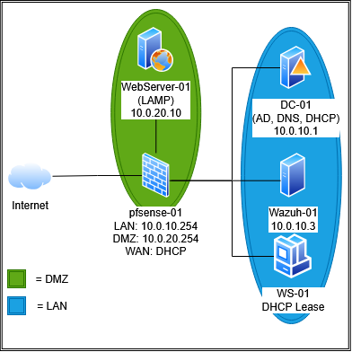

# Segmented Security Home Lab: pfSense, Active Directory, Hardened LAMP, and Wazuh SIEM

A single-host virtual lab (Hyper-V) that simulates a small business network: a firewall with an isolated DMZ, a Windows domain, a hardened Linux web server, and a SIEM that detects attacks against it. Built to practice defensive security, infrastructure, and incident detection end to end.

## What this project demonstrates

| Area | What was done |
|---|---|
| Network segmentation | pfSense with three interfaces (WAN, LAN, DMZ), DMZ isolated from LAN by firewall rule |
| Identity | Windows Server domain `lab.internal` with AD DS, DNS, DHCP, and a domain-joined Windows 10 workstation |
| Linux hardening | Key-only SSH, ufw default-deny, fail2ban, Apache hardening, auditd, Lynis score 74 to 79 |
| Application security | Least-privilege database user, secure vs. deliberately vulnerable PHP app (SQL injection) |
| Detection | Wazuh SIEM with agents on Windows and Linux; alerts for SQL injection, XSS, and web attack patterns |

## Environment

| VM | OS | Zone | IP | Role |
|---|---|---|---|---|
| pfSense-01 | pfSense 2.9.0 (development build) | Edge | WAN: DHCP, LAN: 10.0.10.254, DMZ: 10.0.20.254 | Firewall, router, NAT |
| DC-01 | Windows Server 2025 Standard (evaluation) | LAN | 10.0.10.1 | AD DS, DNS, DHCP |
| WS-01 | Windows 10 Pro | LAN | DHCP (10.0.10.11) | Domain-joined client |
| Wazuh-01 (hostname Wazuh-Server) | Ubuntu 26.04 LTS | LAN | 10.0.10.3 | Wazuh 4.14.9 all-in-one |
| Webserver-01 | Ubuntu 26.04 LTS | DMZ | 10.0.20.10 | Apache, PHP 8.5, MariaDB |

- **Hypervisor:** Hyper-V on a 16-core / 32 GB host
- **Virtual switches:** Default Switch (WAN/NAT), one Private switch for LAN, one Private switch for DMZ
- **Domain:** `lab.internal` (NetBIOS `LAB`)

## Contents

1. [Network and firewall](docs/01-network-and-firewall.md)
2. [Active Directory and Windows](docs/02-active-directory.md)
3. [Web server hardening](docs/03-web-server-hardening.md)
4. [Application security: vulnerable vs. secure](docs/04-application-security.md)
5. [Monitoring and detection with Wazuh](docs/05-wazuh-detection.md)
6. [Troubleshooting and lessons learned](docs/06-lessons-learned.md)
7. [Limitations and future work](docs/07-limitations.md)

Sanitized configuration files are in [`configs/`](configs/).

## Key results

- **DMZ isolation proven:** from the web server, internet access and the Wazuh agent port work; ping and SMB to the domain controller are blocked and logged.
- **Hardening:** password SSH login refused (`Permission denied (publickey)`), Lynis hardening index 74 to 79 (audit tooling and stricter SSH settings), version banners removed, directory listing disabled, five security headers added.
- **Least privilege:** the app's database user cannot `DROP` tables (error 1142).
- **Detection:** Wazuh flagged SQL injection attempts (rule 31164), an XSS attempt (31105), and web attacks returning HTTP 200 (31106).

## Skills practiced

pfSense firewall rules and NAT, Hyper-V networking, Active Directory (OUs, users, groups), DNS, DHCP, Ubuntu administration, SSH key authentication, ufw, fail2ban, Apache and PHP hardening, MariaDB privileges, Lynis auditing, Wazuh deployment and agent management, log analysis, SQL injection fundamentals, technical documentation.
