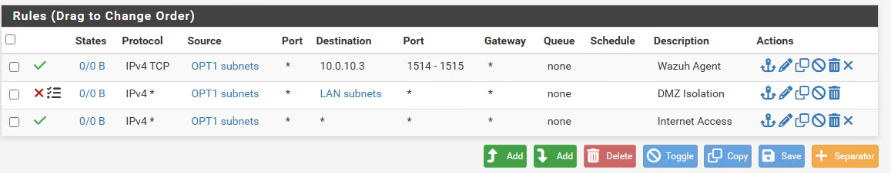
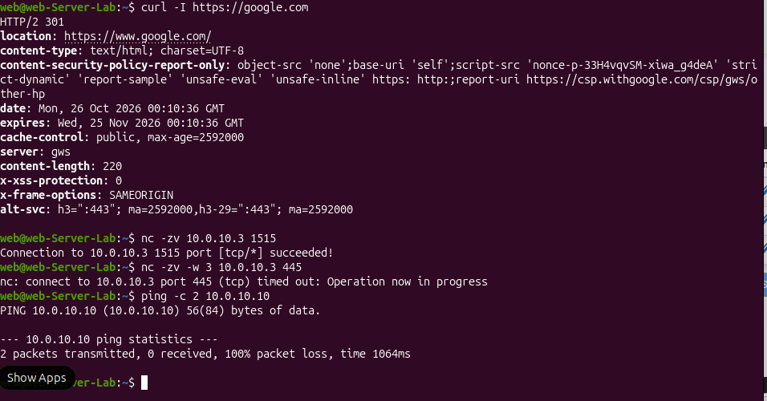
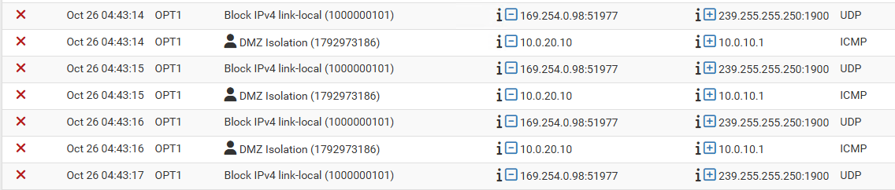

# 1. Network and firewall

## Topology

```
Internet --- [Default Switch/NAT] --- pfSense-01 ---+--- LAN 10.0.10.0/24 (Private switch)
                                      WAN: DHCP     |     DC-01, WS-01, Wazuh-01
                                                    |
                                                    +--- DMZ 10.0.20.0/24 (Private switch)
                                                          Webserver-01
```

A separate router VM was dropped from the original design. pfSense routes between the segments, which saved a VM on a RAM-limited host.

## Design decisions

- **One virtual switch per segment instead of VLANs.** Private switches give real isolation (the only path between LAN and DMZ is through pfSense) with less configuration. VLAN trunking is a possible extension.
- **DMZ for the web server.** A public-facing server should not sit beside the domain controller.
- **pfSense WAN:** "Block private networks" is unchecked because the Hyper-V Default Switch uses a private subnet.

## Interfaces

| Interface | NIC | Address |
|---|---|---|
| WAN | hn0 | DHCP from Default Switch |
| LAN | hn1 | 10.0.10.254/24 |
| OPT1 (DMZ) | hn2 | 10.0.20.254/24 |

## LAN rules

Default "Allow LAN to any" kept. pfSense is stateful, so replies to connections started from the LAN (SSH, browsing the web server, Wazuh enrollment) are allowed automatically.

## DMZ rules (order matters, first match wins)

| # | Action | Protocol | Source | Destination | Port | Purpose |
|---|---|---|---|---|---|---|
| 1 | Pass | TCP | DMZ subnets | 10.0.10.3 | 1514-1515 | Wazuh agent to manager |
| 2 | Block (logged) | Any | DMZ subnets | LAN subnets | any | DMZ isolation |
| 3 | Pass | Any | DMZ subnets | Any | any | Internet and updates |



## Verification

Run from the web server:

```
curl -I https://google.com        # HTTP/2 301, internet works
nc -zv 10.0.10.3 1515             # succeeded, Wazuh rule works
nc -zv -w 3 10.0.10.3 445         # timed out, exception limited to 1514-1515
ping -c 2 10.0.10.10              # 100% loss, DMZ to LAN blocked
```



The pfSense firewall log confirms it. Each ping from the web server (10.0.20.10) to DC-01 (10.0.10.1) is dropped by the **DMZ Isolation** rule on OPT1, which is stronger evidence than the failed ping alone, since Windows Firewall also drops ICMP by default. The other rows are unrelated multicast noise from the DMZ interface (169.254.0.98), blocked by pfSense's default link-local rule.



## Gotchas hit during the build

- A new OPT interface has no rules, so it drops everything until rules are added.
- The first draft of the rule list had the allow-any rule at the top, which would have made the block rule unreachable. Reordering fixed it.
- "OPT1 address" matches the firewall itself; "OPT1 subnets" matches the hosts behind it.
