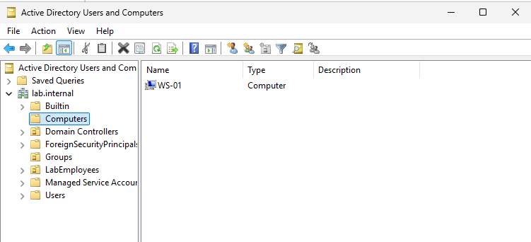
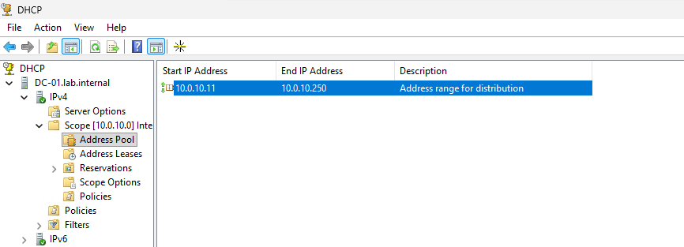
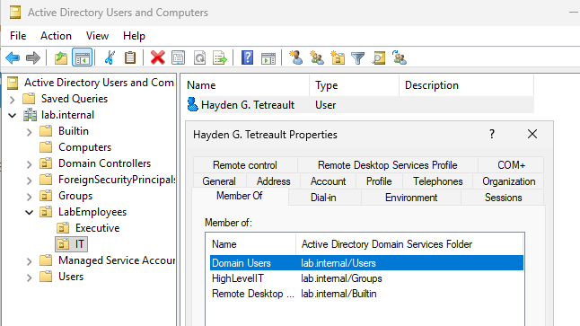

# 2. Active Directory and Windows

## Services on DC-01

- Active Directory Domain Services, domain `lab.internal`
- DNS: DC-01 resolves the domain and forwards other queries to pfSense
- DHCP for the LAN: scope 10.0.10.0/24 with an address pool of 10.0.10.11 to 10.0.10.250. Infrastructure hosts sit outside the pool on static addresses (DC-01 10.0.10.1, Wazuh 10.0.10.3, pfSense 10.0.10.254), so a lease can never collide with them.
- Organizational units: a `LabEmployees` OU with two child OUs, `IT` and `Executive`. The IT OU holds a standard user account; the Executive OU holds a test account.
- Groups: the IT user is a member of `Domain Users`, a custom `HighLevelIT` security group, and the built-in `Remote Desktop Users` group, which allows remote access to domain-joined machines.

## Client

WS-01 (Windows 10 Pro) is domain-joined and gets its address and DNS from DC-01 by DHCP (currently 10.0.10.11, the first address in the pool).

## Naming

`lab.internal` was chosen because `.internal` is reserved for private use. It avoids the mDNS conflicts that `.local` can cause with Linux clients and avoids colliding with a real public domain.

## Evidence to add

## Not implemented

No Group Policy objects were configured, including baseline policies for browsers or Windows hardening. Access rules in this lab rely on group membership only.

A second domain controller for redundancy and recovery practice was planned and not built. See [Limitations](07-limitations.md).
