# 3. Web server hardening (Webserver-01)

Ubuntu Server in the DMZ at 10.0.20.10, running Apache, PHP 8.5, and MariaDB (Ubuntu 26.04 LTS).

## SSH

- OpenSSH server installed and restricted to the LAN by ufw
- Ed25519 key with passphrase, from the DC-01 management host
- Password authentication disabled, root login disabled, `AllowUsers web`

Config: [`configs/sshd-01-hardening.conf`](../configs/sshd-01-hardening.conf)

**Proof:**

```
ssh -o PubkeyAuthentication=no web@10.0.20.10
web@10.0.20.10: Permission denied (publickey).
```

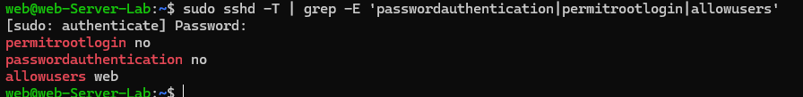
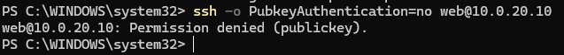

## Firewall (ufw)

Default deny inbound, allow outbound. SSH only from 10.0.10.0/24; HTTP and HTTPS open.

Rules: [`configs/ufw-rules.txt`](../configs/ufw-rules.txt)

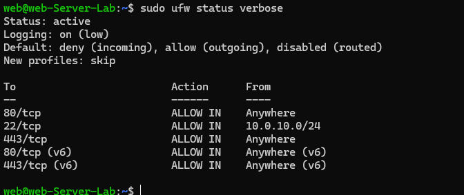

## fail2ban

sshd jail with `maxretry = 4`, `findtime = 10m`, `bantime = 1h`, reading from the systemd journal.

Config: [`configs/fail2ban-jail.local`](../configs/fail2ban-jail.local)

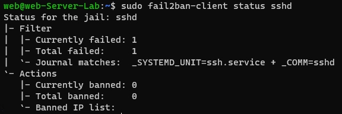

Before the test the jail was active with one failure counted and no bans. After repeated failed logins from WS-01 (`ssh -o PubkeyAuthentication=no baduser@10.0.20.10`), the jail banned that address:

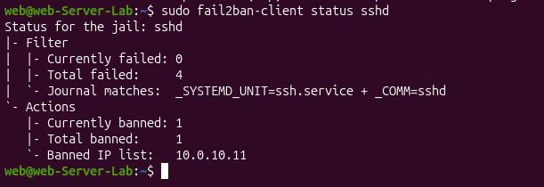

Four failures were recorded and 10.0.10.11 was banned for one hour. Even with password login disabled, each rejected attempt still counts toward the ban.

## Attack surface scan

`nmap -sV` from a LAN host shows only SSH and HTTP exposed, with everything else filtered.

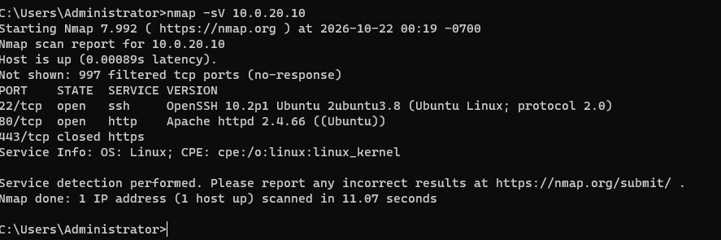

This scan was taken before the Apache hardening below and still reports the exact Apache version. After hardening, the same scan reports only `Apache httpd`, and a headers scan shows the security headers as an outside scanner sees them:

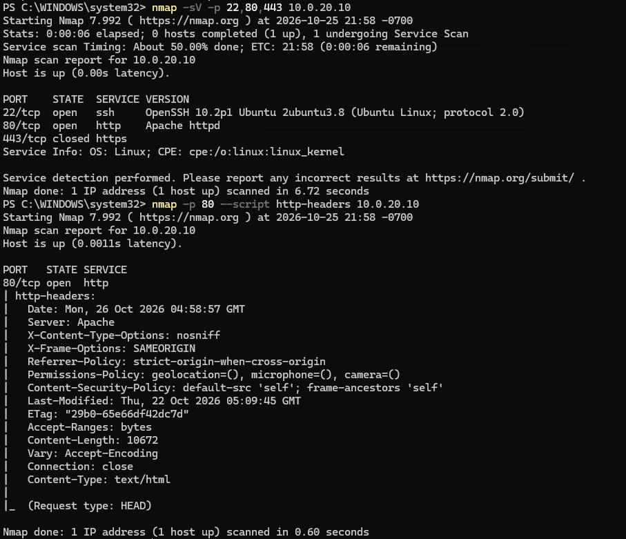

OpenSSH still discloses its version (`OpenSSH 10.2p1 Ubuntu`), which is not easily hidden; keeping the package patched is the mitigation (unattended-upgrades is enabled).

## Apache hardening

| Setting | Before | After |
|---|---|---|
| `Server` header | `Apache/2.4.66 (Ubuntu)` | `Apache` |
| 404 page footer | Version and port disclosed | Removed |
| Directory listing | `/testdir/` listed `secret.txt` | 403 Forbidden |
| Security headers | None | X-Content-Type-Options, X-Frame-Options, Referrer-Policy, Permissions-Policy, Content-Security-Policy |

Config: [`configs/apache-zz-hardening.conf`](../configs/apache-zz-hardening.conf)

The file is named `zz-` so it loads after Ubuntu's default `security.conf`, which sets `ServerTokens OS`; the last setting wins.

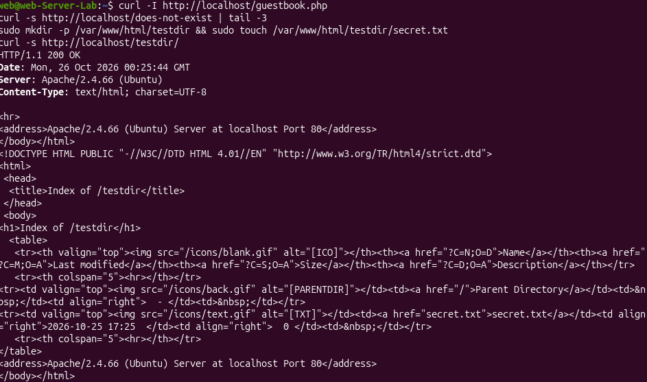
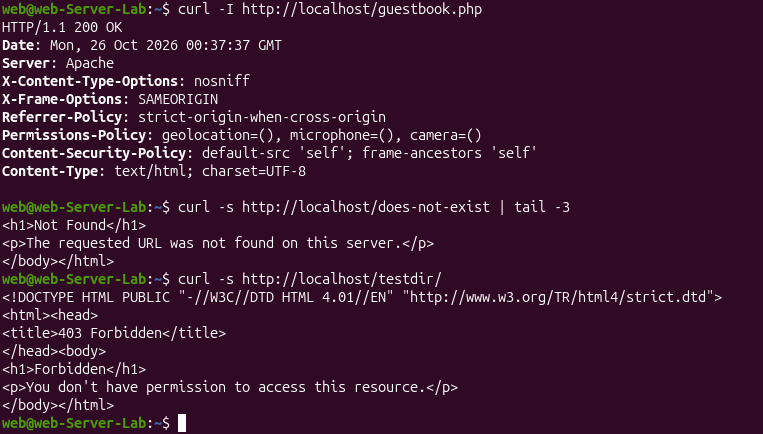

## System hardening and Lynis

The 74 baseline was taken after the SSH, ufw, fail2ban, and Apache hardening above. Two further changes were then made:

1. Installed packages that Lynis checks for: `auditd` (audit logging), `unattended-upgrades` (automatic security patches), `debsums` (package file integrity), `acct` (process accounting), `sysstat`, `libpam-tmpdir`, `apt-show-versions`, and `apt-listchanges`.
2. Added further SSH restrictions to the hardening file: `AllowTcpForwarding no`, `AllowAgentForwarding no`, `MaxSessions 2`, `TCPKeepAlive no`, and `LogLevel VERBOSE`.

| | Before | After |
|---|---|---|
| Hardening index | 74 | 79 |
| Tests performed | 263 | 266 |

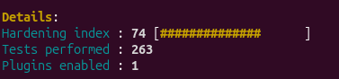
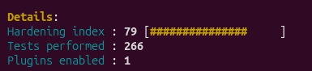

**Reading the score honestly:** the 5-point gain came from the audit and patching tooling and the stricter SSH settings. The Apache hardening did not move the score, because Lynis awards little for web server settings. It is better shown by the before/after `curl` and nmap output above. Some remaining Lynis suggestions were deliberately skipped because they trade usability for small gains.

## Not done

HTTPS with a self-signed certificate and HSTS were planned and not implemented.
