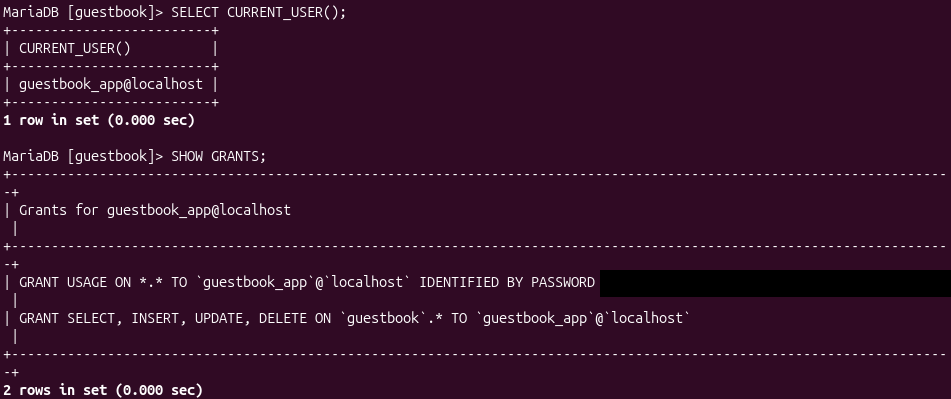
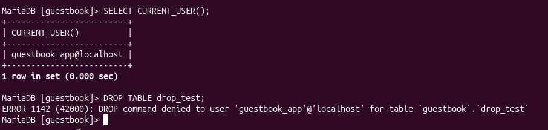
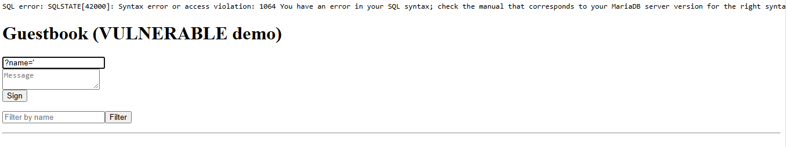
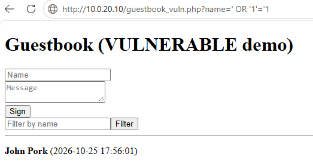
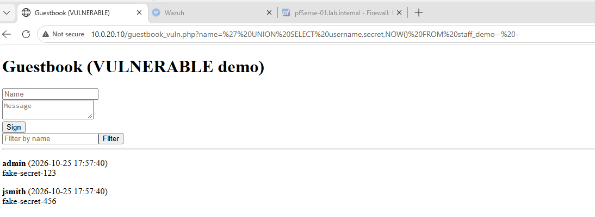
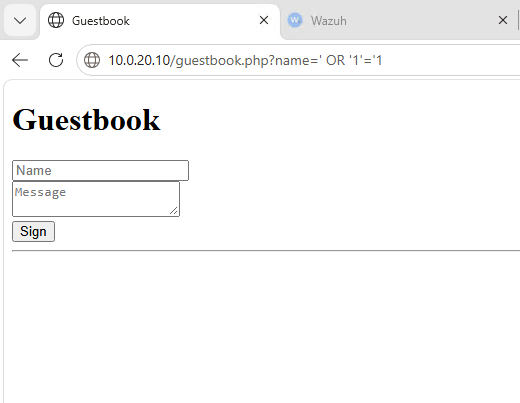
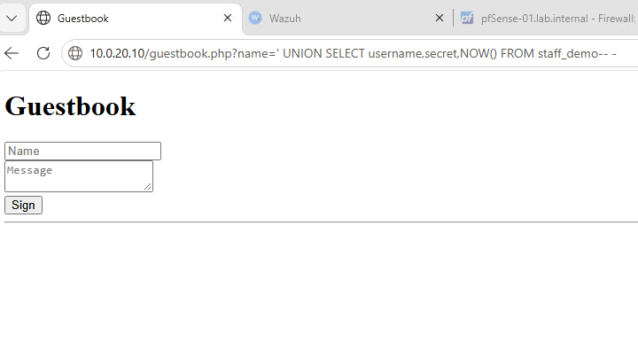

# 4. Application security: vulnerable vs. secure

A small PHP guestbook backed by MariaDB, built in a secure version and a deliberately vulnerable copy to compare attacks, defenses, and detections. The vulnerable page was restricted to the LAN and was removed once testing finished, along with its demo tables.

## Least-privilege database user

The app connects as `guestbook_app`, which has only `SELECT, INSERT, UPDATE, DELETE` on the `guestbook` database. Credentials live in `/etc/guestbook/config.php` (root:www-data, mode 640), outside the web root.

```
SELECT CURRENT_USER();      -> guestbook_app@localhost
DROP TABLE entries;         -> ERROR 1142: DROP command denied
```



The privilege test, run against a throwaway table so the app's real data was never at risk:



> Lesson: the first `DROP TABLE` test succeeded because it was run as root by mistake. `SELECT CURRENT_USER();` before testing privileges avoids that. The password hash in the screenshot is redacted.

Setup script: [`configs/guestbook-db-setup.sql`](../configs/guestbook-db-setup.sql)

## Secure vs. vulnerable code

| | Secure (`guestbook.php`) | Vulnerable demo |
|---|---|---|
| SQL | `prepare('... WHERE name = ?')` | `"... WHERE name = '$filter'"` |
| Output | `htmlspecialchars()` | Raw output |
| Errors | Exceptions not displayed | Raw SQL error shown |

## Attacks run (from DC-01)

| Test | Payload | Vulnerable page | Secure page |
|---|---|---|---|
| 1. Error disclosure | `?name='` | Raw `SQLSTATE[42000]` MariaDB error | No error |
| 2. Filter bypass | `?name=' OR '1'='1` | Returns entries regardless of filter | No rows |
| 3. Data leak | `?name=' UNION SELECT username,secret,NOW() FROM staff_demo-- -` | Fake secrets displayed as entries | No rows |

**Vulnerable page**





**Secure page, same payloads**




## Takeaways

- Prepared statements stop SQL injection: the same payloads that errored, bypassed the filter, and leaked data on the vulnerable page returned nothing on the secure one.
- A least-privilege DB account limits what a successful injection can do.
- `staff_demo` contained fake data only.
