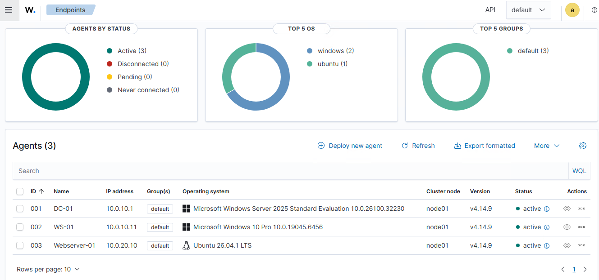
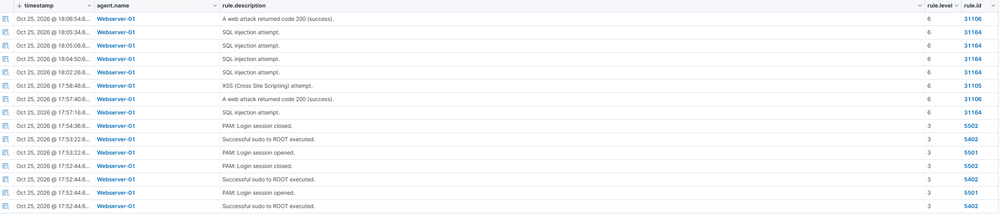
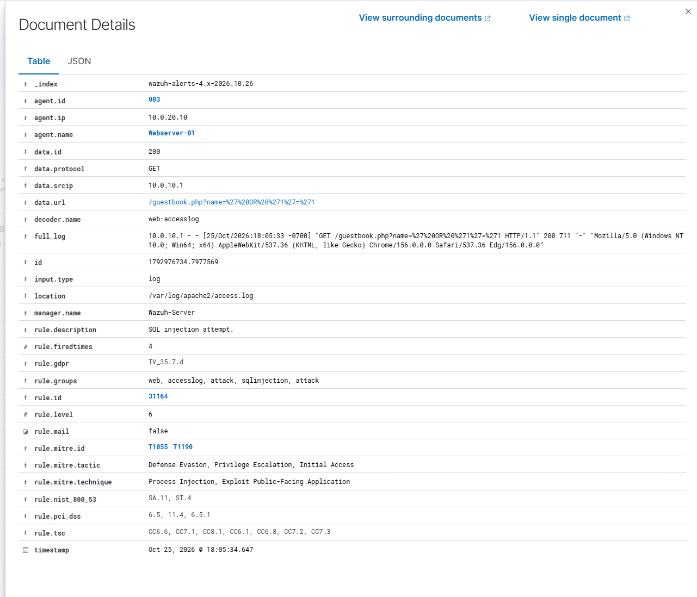
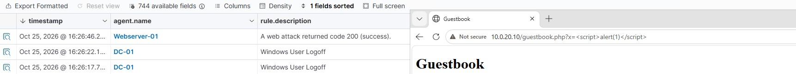

# 5. Monitoring and detection with Wazuh

## Deployment

Wazuh 4.14.9 all-in-one (manager, indexer, dashboard) on an Ubuntu 26.04 LTS VM (Wazuh-01, hostname Wazuh-Server) at 10.0.10.3, 8 GB RAM `TODO(verify)`, fixed memory. Dashboard at `https://10.0.10.3`.

## Agents

| Agent | OS | Network path |
|---|---|---|
| 001 DC-01 | Windows Server 2025 | LAN, direct |
| 002 WS-01 | Windows 10 Pro | LAN, direct |
| 003 Webserver-01 | Ubuntu 26.04 LTS | DMZ, allowed by pfSense rule on TCP 1514-1515 |

The Linux agent monitors the Apache access and error logs, auth logs, and the journal.

## Detections observed

| Rule ID | Description | Triggered by |
|---|---|---|
| 31164 | SQL injection attempt | `OR '1'='1'`, `UNION SELECT` URLs |
| 31105 | XSS (cross-site scripting) attempt | A `<script>` tag in a request URL (a probe, not a full XSS test) |
| 31106 | A web attack returned code 200 | Attack patterns that got an HTTP 200 |
| 5402 / 5501 / 5502 | sudo to root, PAM session open/close | Admin activity on the web server |

An expanded SQL injection alert (rule 31164) shows the source IP (10.0.10.1, DC-01), the requested URL, the raw Apache log line, and the MITRE ATT&CK mapping (T1190, Exploit Public-Facing Application):

The `<script>` URL probe as it appeared in Wazuh, next to the request that caused it:

**Query used:** `agent.name: "Webserver-01" and rule.groups: web`

## Limits of this detection

- Wazuh flagged the **pattern** in the request, not whether the attack worked. Rule 31106 fires on HTTP 200 for any attack-looking request; only the vulnerable page actually leaked data. The alert detail above is for a request to the secure page, which returned 200 and no data.
- The Apache access log records URLs but not POST bodies, so attacks submitted in form (POST) bodies are not visible. Catching it would need a WAF such as ModSecurity or application-level logging.
- Default rules only; no custom decoders or tuning.
